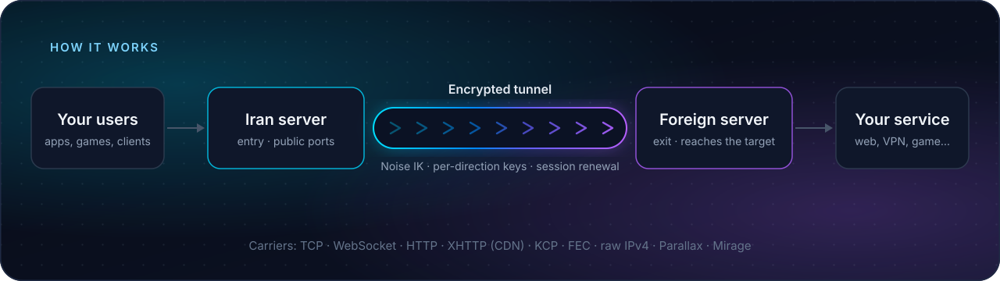
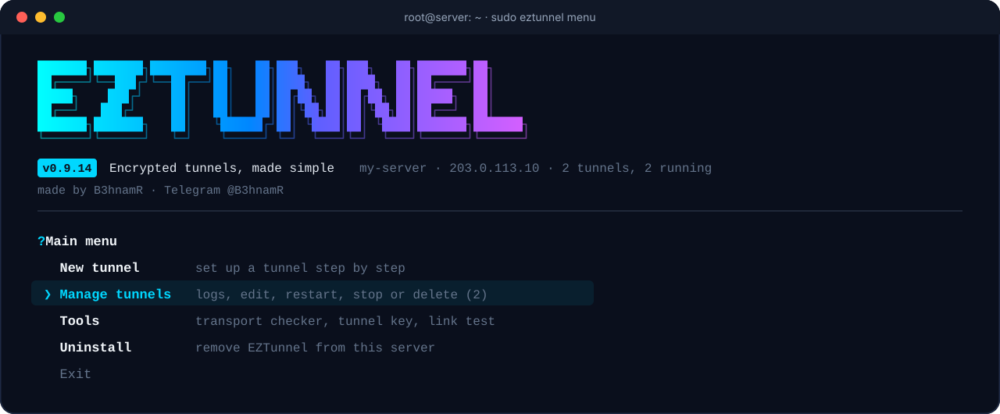

<p align="center">
  
</p>

<p align="center">
  <a href="https://github.com/B3hnamR/EZTunnel/releases/latest"></a>
  <a href="LICENSE"></a>
  
  
</p>

<p align="center">
  <a href="#quick-start"><b>Quick start</b></a> ·
  <a href="#how-it-works"><b>How it works</b></a> ·
  <a href="#transports"><b>Transports</b></a> ·
  <a href="#what-can-it-carry"><b>What it carries</b></a> ·
  <a href="#mirage"><b>Mirage</b></a> ·
  <a href="#roadmap"><b>Roadmap</b></a> ·
  <a href="#documentation"><b>Docs</b></a>
</p>

---

**EZTunnel** connects two Linux servers with an encrypted tunnel. Forward TCP and
UDP ports, offer a SOCKS5 proxy, or carry whole IP networks through a TUN
interface, all from a guided terminal manager, with no config files to write.

- **Simple:** answer a few questions on one server, paste one code on the other. Done.
- **Secure:** every tunnel uses Noise IK authentication, encryption with separate keys
  per direction, and automatic session renewal.
- **Flexible:** 15 transports, from plain TCP to WebSocket, CDN-friendly XHTTP,
  loss-resistant FEC and raw IPv4 carriers.
- **Yours:** open source and self-hosted, with no telemetry. It only talks to the
  servers you configure.

## How it works

<p align="center">
  
</p>

You install EZTunnel on **two servers** and give each one a role:

| Role | What it does |
|---|---|
| **Iran** (entry) | Accepts your users' connections on the ports you choose. |
| **Foreign** (exit) | Receives the traffic through the tunnel and reaches the real destination. |

The role names are just labels; any two servers you are allowed to use will work.
Traffic between the two is always encrypted and authenticated, whatever transport
carries it.

## Quick start

### 1. Install on both servers

Run this as root on **each** server:

```bash
bash <(curl -fsSL https://raw.githubusercontent.com/B3hnamR/EZTunnel/main/scripts/install-latest.sh)
```

The installer picks the right build for your CPU (x86_64 or ARM64), checks it
against the release's `SHA256SUMS`, and installs `/usr/local/bin/eztunnel`. It
never starts, stops or changes existing tunnels.

<details>
<summary><b>Prefer to read the installer first, or pin a version?</b></summary>

```bash
curl -fsSLo install-eztunnel.sh https://raw.githubusercontent.com/B3hnamR/EZTunnel/main/scripts/install-latest.sh
less install-eztunnel.sh
sudo bash install-eztunnel.sh                      # latest release
sudo bash install-eztunnel.sh --version v0.9.14    # a specific release
```

**Requirements:** Linux, Bash, `curl`, `tar`, coreutils and `flock` (from
util-linux). systemd for managed services. TUN needs `/dev/net/tun` and iproute2;
raw transports need root and an Ethernet interface.

| `uname -m` | Release asset |
|---|---|
| `x86_64` / `amd64` | `eztunnel-linux-x86_64.tar.gz` |
| `aarch64` / `arm64` | `eztunnel-linux-aarch64.tar.gz` |

Checksums catch corrupted or mismatched downloads; they do not protect against a
compromised GitHub account. The installer backs up an existing binary and will not
fall back to an older or wrong-CPU release.

</details>

### 2. Open the manager

```bash
sudo eztunnel menu
```

<p align="center">
  
</p>

### 3. Create the tunnel on the first server

Choose **New tunnel → Step by step** and answer the questions:

1. **This server's role:** Iran or Foreign.
2. **Who connects to whom:**
   - **Reverse:** the Foreign server connects to the Iran server.
   - **Direct:** the Iran server connects to Foreign.
3. **Transport:** start with **TCP**. Not sure? See [Choosing a transport](#choosing-a-transport).
4. **Key and address:** let it generate a fresh tunnel key, then enter the other
   server's real IP and the tunnel port.
5. **What to carry:** port forwarding, SOCKS5, TUN, or TUN + ports.
6. **Save and start.** The manager shows a **pairing code** (`ezt1-…`). Copy it.

> [!IMPORTANT]
> The pairing code contains the tunnel's secret key. Send it only through a private channel.

### 4. Paste the code on the second server

On the other server choose **New tunnel → Paste a pairing code**, paste it, review
the settings and choose **Save and start**. No SSH access between the servers is
needed.

### 5. Check it works

Open **Manage tunnels → your tunnel → Live status**. You should see connected
sessions and traffic. Then test your real application.

<details>
<summary><b>Example: forward a web service on port 443</b></summary>

You run a web service on the Foreign server at `127.0.0.1:443` and want users to
reach it through the Iran server on port `8443`:

```text
Users ──▶ Iran:8443 ══ encrypted tunnel ══▶ Foreign ──▶ 127.0.0.1:443
```

In the forwarding step, enter `8443=443`. That's it. Users now connect to
`IRAN_IP:8443`.

The service must already be running on the Foreign server; the tunnel does not
create it. Open port 8443 in the Iran server's firewall or provider panel if needed.

</details>

> [!TIP]
> Not sure which transport works on your route? Run **Tools → Transport checker**
> first. It tests real temporary tunnels between your two servers and shows which
> transports connect, how fast, and with what latency, then creates the tunnel for you.

## Transports

All transports carry the same encrypted, authenticated tunnel. They only change
**how the packets look on the network and how they handle loss.** Both servers must
use the same transport.

### Choosing a transport

| Your situation | Try |
|---|---|
| Just starting, or the network is clean | **TCP** |
| Plain TCP gets blocked or throttled | **WSS**, then **XHTTPS** |
| You want to go through a CDN or HTTP proxy | **XHTTPS** (or **XHTTP**) |
| The link loses many packets | **FEC-UDP** |
| UDP and TCP are both filtered, and you control both servers fully | **FEC-RAW** |
| Games or real-time traffic on a lossy raw path | **FEC-RAW-GAMING** |
| You need a full IP network (TUN) over raw packets | **RAW-TUN** |
| Your provider allows source-address spoofing and you have tested it | **Mirage** |

> [!NOTE]
> No transport is invisible. How a carrier looks is not a guarantee against traffic
> analysis or provider filtering. Measure on your own route.

### All 15 transports

Click a transport for what it does, when to use it, and how to set it up.

<details>
<summary><b>TCP</b>: plain and fast, the best first choice</summary>

**What it is:** the encrypted tunnel sent directly over TCP connections.

**Use it when:** you are setting up your first tunnel, or TCP works fine on your route.
It has the lowest overhead and the simplest setup.

**Set up:** in the wizard pick **TCP**. In JSON: `"transport": "tcp"` (the default).
Open the tunnel port on the server that listens.

</details>

<details>
<summary><b>TCP6</b>: TCP between IPv6 addresses</summary>

**What it is:** the same as TCP, but the two servers talk over IPv6.

**Use it when:** both servers have working IPv6 and you prefer it over IPv4.

**Set up:** pick **TCP6** and enter literal IPv6 addresses, written as
`[2001:db8::1]:443` on both ends. In JSON: `"transport": "tcp6"`.

</details>

<details>
<summary><b>WSS</b>: WebSocket inside TLS, looks like HTTPS</summary>

**What it is:** the tunnel inside binary WebSocket messages, wrapped in TLS.

**Use it when:** plain TCP is filtered and HTTPS traffic passes. A good second choice
after TCP.

**Set up:** pick **WSS**. The manager can create the TLS certificate from the tunnel
key automatically (`tls_auto`), so there are no certificate files to copy. Both ends
must use the same HTTP path (default `/tunnel`). In JSON: `"transport": "wss"`.

</details>

<details>
<summary><b>WS</b>: WebSocket without TLS</summary>

**What it is:** WSS without the TLS layer.

**Use it when:** only for testing, or behind your own TLS-terminating proxy. Plain WS
is often blocked, especially when the Foreign server dials in. Prefer **WSS**.

**Set up:** pick **WS**. In JSON: `"transport": "ws"`.

</details>

<details>
<summary><b>XHTTPS</b>: HTTP requests inside TLS, works through a CDN</summary>

**What it is:** the tunnel split into ordinary HTTP requests: uploads as POST
requests and downloads as a streaming response. Proxies and CDNs can forward it
without understanding the tunnel.

**Use it when:** you want to put a CDN or HTTP reverse proxy between your users and
the server, or WebSocket is blocked.

**Set up:** pick **XHTTPS**. For a CDN, point your CDN hostname at the server and set
the host name and, optionally, specific CDN edge addresses in the XHTTP settings.
Upload mode: `auto` detects what the path supports; `packet-up` is the safest
through buffering proxies. In JSON: `"transport": "xhttps"` with an `xhttp` block.
See [XHTTP and CDN setup](docs/xhttp.md).

</details>

<details>
<summary><b>XHTTP</b>: HTTP requests without TLS</summary>

**What it is:** XHTTPS without TLS, for paths where TLS is added by a CDN or proxy in
front of the server.

**Use it when:** your CDN or proxy terminates TLS for you.

**Set up:** pick **XHTTP**. In JSON: `"transport": "xhttp"`. See [XHTTP setup](docs/xhttp.md).

</details>

<details>
<summary><b>HTTPS</b>: HTTP upgrade inside TLS</summary>

**What it is:** an HTTP/1.1 connection upgrade carrying the tunnel, inside TLS.

**Use it when:** HTTPS passes but you want a different shape from WebSocket.

**Set up:** pick **HTTPS**. TLS works like WSS (`tls_auto` or your own certificate),
and both ends use the same HTTP path. In JSON: `"transport": "https"`.

</details>

<details>
<summary><b>HTTP</b>: HTTP upgrade without TLS</summary>

**What it is:** HTTPS without the TLS layer.

**Use it when:** testing only. It is often blocked, especially when the Foreign
server dials in. Prefer **HTTPS**.

**Set up:** pick **HTTP**. In JSON: `"transport": "http"`.

</details>

<details>
<summary><b>KCP</b>: reliable stream over UDP</summary>

**What it is:** the tunnel over UDP using the KCP protocol, which resends lost packets
faster than TCP.

**Use it when:** UDP passes well and TCP is slow on long or busy routes. Plain KCP is
easy to recognize and often blocked, especially when the Foreign server dials in.

**Set up:** pick **KCP** and open the UDP tunnel port. In JSON: `"transport": "kcp"`.
Window size, MTU and resend settings are in the [configuration reference](docs/configuration.md).

</details>

<details>
<summary><b>FEC-UDP</b>: UDP with error correction, for very lossy links</summary>

**What it is:** KCP plus forward error correction: for every 10 data packets one
repair packet is sent, so many losses are repaired without waiting for a resend.

**Use it when:** your link drops a lot of packets and TCP-based transports stall.

**Set up:** pick **FEC-UDP**. Open the UDP tunnel port **and** its knock port (the
tunnel port + 10000, or − 1000 if that would overflow). In JSON:
`"transport": "fec-udp"`. Tuning is explained in [FEC tuning](docs/fec-tuning.md).

</details>

<details>
<summary><b>FEC-RAW</b>: raw IP packets with error correction (advanced)</summary>

**What it is:** the FEC stream inside hand-built IPv4 packets. You choose how the
outer packets look: TCP, UDP, ICMP, GRE, IPIP, DNS and other profiles.

**Use it when:** normal TCP and UDP sockets are filtered, and you have root on both
servers.

**Set up:** pick **FEC-RAW**, choose a packet profile (TCP-looking is recommended),
the network interface, and both servers' real IPs. Uses one connection. For the
TCP-looking profile the manager adds, and later removes, its own firewall rule so the
kernel does not reset the fake connection. In JSON: `"transport": "fec-raw"` with a
`raw` block. See [raw carriers](docs/raw-protocol.md).

</details>

<details>
<summary><b>FEC-RAW-GAMING</b>: the same, tuned for low delay (advanced)</summary>

**What it is:** FEC-RAW with a preset that favors low delay over throughput.

**Use it when:** you carry games or real-time traffic over a raw path. It is not a
promise of lower game latency on every route; compare with the transport checker.

**Set up:** like FEC-RAW, pick **FEC-RAW-G**. In JSON: `"transport": "fec-raw-gaming"`.

</details>

<details>
<summary><b>RAW-TUN</b>: raw IP packets for a TUN network (advanced)</summary>

**What it is:** carries a TUN interface's IP packets as individual authenticated
raw datagrams instead of a reliable stream, like a lightweight VPN.

**Use it when:** you want a TUN network over raw packets and your applications
handle their own loss (for example a VPN or games inside the TUN).

**Set up:** choose **TUN** as what to carry and **RAW-TUN** as the transport. Needs
root, raw settings and matching TUN addresses on both servers. In JSON:
`"transport": "tun"` with `tun` and `raw` blocks. See [raw TUN](docs/raw-tun.md).

</details>

<details>
<summary><b>Parallax</b>: authenticated directional TCP lanes</summary>

**What it is:** a pair of separate TCP lanes, one per direction, with bounded
packet batching.

**Use it when:** a single two-way TCP connection performs badly on your route, and
both servers run an EZTunnel version with Parallax support.

**Set up:** pick **Parallax** on both servers. In JSON: `"transport": "parallax"`.

</details>

<details>
<summary><b>Mirage</b>: experimental spoofed-source raw transport</summary>

**What it is:** raw IPv4 packets whose source address can be set to an address you
are permitted to use, with independent packet profiles per direction.

**Use it when:** your providers allow it and you have **tested** which sources and
profiles work on your route. See [Mirage](#mirage) below for the guided test-first setup.

**Set up:** start with **Tools → Mirage source tests**, which tests first and then
creates the tunnel. In JSON:
`"transport": "mirage"`. See the [Mirage guide](docs/mirage-guided.md).

</details>

## What can it carry?

| Mode | What you get | Typical use |
|---|---|---|
| **Port forwarding** | TCP and UDP ports on Iran forwarded to targets on Foreign | Web servers, proxies, game servers |
| **SOCKS5** | A SOCKS5 proxy on one side that exits on the other | Apps that support a proxy |
| **TUN** | A virtual network interface; whole IPv4/IPv6 networks | Site-to-site links, VPN-like setups |
| **TUN + ports** | A TUN network plus port forwarding over it | Both at once |

<details>
<summary><b>Details and limits</b></summary>

- **TCP forwarding:** many streams at once, with backpressure and half-close.
- **UDP forwarding:** datagrams up to 16 KiB. Delivery depends on the transport's
  reliable or direct datagram path.
- **SOCKS5:** TCP CONNECT and UDP ASSOCIATE. No username/password, BIND or
  fragmentation, so keep the listener private or firewalled.
- **TUN:** layer-3 IPv4/IPv6 packets over stream or raw transports.
- **Exit control:** the Foreign side only connects to destinations on its allowlist.

</details>

## Mirage

Mirage sends raw IPv4 packets with a source address you choose, with separate
packet profiles for each direction. Use it **only with servers, networks and source
addresses you are permitted to use.** Whether it works depends on your providers'
filtering and routes, so EZTunnel makes you **test first**.

<details>
<summary><b>Step-by-step: test, then create a Mirage tunnel</b></summary>

```bash
sudo eztunnel spooftest menu
```

1. **On Iran:** choose **Start on Iran**, enter both servers' real addresses and your
   permitted spoof IPs, then pick profiles and a quick or extended sample.
2. Copy the temporary `ezm-test1-…` invitation, then **press Enter** to open the live
   results table. Press `i` any time to show the invitation again.
3. **On Foreign:** choose **Join on Foreign** and paste the invitation. It is valid
   for 10 minutes and one run.
4. Watch receipt, loss and return delay for each source, profile and direction.
   Results are saved, even partial ones.
5. Pick a working result and **create the tunnel**. A fresh permanent key is made;
   the test key is never reused.
6. Paste the `ezm-setup1-…` code on the other server through **New tunnel → Paste a
   pairing code** and confirm **Save and start** on each server.

| Profile | Outer IPv4 protocol |
|---|---:|
| TCP | 6 |
| UDP | 17 |
| ICMP | 1 |
| GRE | 47 |
| IPIP | 4 |
| BIP (bare protocol 58) | 58 |
| Echo-shaped protocol 58 | 58 |

Uplink is Foreign → Iran and downlink is Iran → Foreign; each can use a different
profile. No address scanning, firewall opening or remote SSH is done for you. Advanced
options (source pools, TTL/DSCP, padding, repair) cost bandwidth; cosmetic framing is
not real TLS.

[Guided Mirage setup](docs/mirage-guided.md) · [Mirage reference](docs/mirage.md)

</details>

## Managing tunnels

| In the manager | What you can do |
|---|---|
| **Manage tunnels** | Live status, traffic, latency, reconnects, logs, start/stop/restart, ports, settings, speed tests, delete |
| **All tunnels** | Start, stop or change settings on many tunnels at once |
| **Tools → Transport checker** | Test which transports work between your servers, then create a tunnel |
| **Tools → Mirage source tests** | Find working spoof sources and profiles per direction |
| **Tools → Link test** | Check TCP, UDP, reachability and MTU between two servers |
| **Backup / import** | Export and restore your tunnel configurations |
| **Optimize / undo** | Preview and apply optional kernel tuning, or undo it |

Each tunnel is one private JSON file in `/etc/eztunnel/tunnels/` and one systemd
service named `eztunnel-NAME.service`. Keep configs, backups and codes private.

<details>
<summary><b>Updating to a new version</b></summary>

Run the installer again on each server. It replaces the program file but **does not
restart** running tunnels, so they keep the old version until you restart them:

```bash
sudo systemctl restart eztunnel-NAME.service
```

A restart briefly drops that tunnel. If your SSH session runs through it, use another
connection first. Update both servers to the same version: the transport checker
requires equal versions, and 0.9.x cannot connect to versions before 0.9.0.

</details>

<details>
<summary><b>Optional transport extensions (advanced, off by default)</b></summary>

| Option | Purpose |
|---|---|
| Adaptive controller | RTT- and queue-aware scheduling for FEC transports |
| Shared bandwidth allocation | Share a path fairly between loaded sessions |
| TCP packet fallback | An authenticated backup lane when the raw path stops working |
| Adaptive port hopping | Authenticated, bounded raw port changes |
| UDP migration | Keep UDP flows alive when the channel changes |
| Direct gaming datagrams | A separate unreliable UDP path for ports and SOCKS UDP |

Don't turn them all on hoping for better gaming. Start with the defaults, measure,
and enable one only for a specific problem. See [transport extensions](docs/transport-upgrade.md).

</details>

## Roadmap

Coming next to EZTunnel:

| Feature | What it brings |
|---|---|
| **Seamless failover** | Give a tunnel backup routes: another transport, or another foreign server. If the main route fails or slows down, traffic moves to a backup automatically and returns when the main route recovers. The user port never changes, open connections pause for a moment and continue instead of dropping, and game traffic keeps its session. |
| **Telegram alerts** | A Telegram bot that tells you the moment a tunnel drops, reconnects, reaches its quota or a server restarts, so you know before your users do. |
| **Web dashboard** | A full web dashboard, installed on any server (usually the Iran server), to watch every tunnel live and to create, edit, start and stop tunnels on all your servers from the browser, without a terminal. It shows the tunnels already on its server, connects your other servers with one join command, and comes in English and Persian. |
| **Three new anti-censorship transports** | New carriers built to get through heavy filtering where today's transports are blocked or throttled. |

Planned features may change before they ship. Follow the [releases](https://github.com/B3hnamR/EZTunnel/releases) to see them land.

## Using JSON instead of the menu

<details>
<summary><b>Configure and run from the command line</b></summary>

```bash
eztunnel key                            # make a tunnel key
eztunnel --gen server > server.json     # starter config for the listening side
eztunnel --gen client > client.json     # starter config for the dialing side
chmod 600 server.json client.json
# edit the peer address, key, port maps and the exit allowlist
eztunnel --config server.json --check   # validate the file
eztunnel --config server.json           # run it
```

`--check` validates the file only; it does not test the network. `eztunnel --help`
lists every command and `eztunnel settings` prints every numeric setting with its range.
Examples are in [`examples/`](examples/); every field is described in the
[configuration reference](docs/configuration.md).

</details>

## Building from source

<details>
<summary><b>Build on Linux or WSL</b></summary>

```bash
git clone https://github.com/B3hnamR/EZTunnel.git
cd EZTunnel
cargo build --locked --release
cargo test --locked --release --all-targets
```

The default build includes browser-compatible TLS and needs a C/C++ toolchain, CMake
and libclang. `--no-default-features` builds without browser TLS (not full feature
parity). Releases are validated with Rust 1.98.1.

Static release builds:

```bash
rustup target add x86_64-unknown-linux-musl
# set EZTUNNEL_ZIG, EZTUNNEL_CLANGXX and LIBCLANG_PATH as in docs/build-from-source.md
bash scripts/build-x86_64-musl.sh
bash scripts/package-linux.sh target/x86_64-unknown-linux-musl/release/eztunnel dist
```

For ARM64 use [`scripts/build-aarch64-cross.sh`](scripts/build-aarch64-cross.sh).
Never rename an x86 binary as ARM. Run privileged TUN/raw tests only in disposable
namespaces or VMs. Full details: [build from source](docs/build-from-source.md) ·
[architectures](docs/architectures.md).

</details>

## Documentation

| Get started | Reference |
|---|---|
| [Your first tunnel](docs/first-tunnel.md) | [Configuration](docs/configuration.md) |
| [Transport checker](docs/checker.md) | [Security model](docs/security.md) |
| [Mirage guided setup](docs/mirage-guided.md) | [Mirage reference](docs/mirage.md) |
| [XHTTP and CDN setup](docs/xhttp.md) | [Wire protocol](docs/protocol.md) |
| [Link diagnostics](docs/linktest.md) | [Raw carriers](docs/raw-protocol.md) |
| [FEC tuning](docs/fec-tuning.md) | [Raw TUN](docs/raw-tun.md) |
| [Two-server validation](docs/two-server-test.md) | [Architecture](docs/architecture.md) |
| [Transport extensions](docs/transport-upgrade.md) | [Build from source](docs/build-from-source.md) |

## Release quality

**v0.9.14** is a full dual-CPU release: 563/563 tests pass on x86_64 and natively on
ARM64, plus the kernel runtime matrix (24/24 on each CPU) and the Mirage runtime
matrix. Both binaries are static musl builds from the same source.

Releases are not signed with the official update key unless stated, so the built-in
`update` command does not install them; use the installer or replace the binary.

## License

Copyright (C) 2026 EZTunnel contributors.

EZTunnel is free software under the **GNU Affero General Public License v3.0 only**
(AGPL-3.0-only); see [LICENSE](LICENSE). If you modify EZTunnel and share it, or let
others use your modified version over a network, you must publish your changes under
the same license.

The vendored KCP crates keep their own licenses in [`vendor/`](vendor/), and the XDP
monitor in `scripts/xdp/` keeps its GPL-2.0 header. Release archives include the
notices of all third-party components built into the binaries.

Use raw and spoofing features only where you are authorized and your providers allow it.

<p align="center">
  <sub>Made by <a href="https://github.com/B3hnamR">B3hnamR</a> · Telegram <a href="https://t.me/B3hnamR">@B3hnamR</a></sub>
</p>
